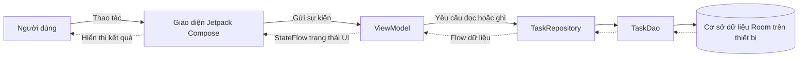
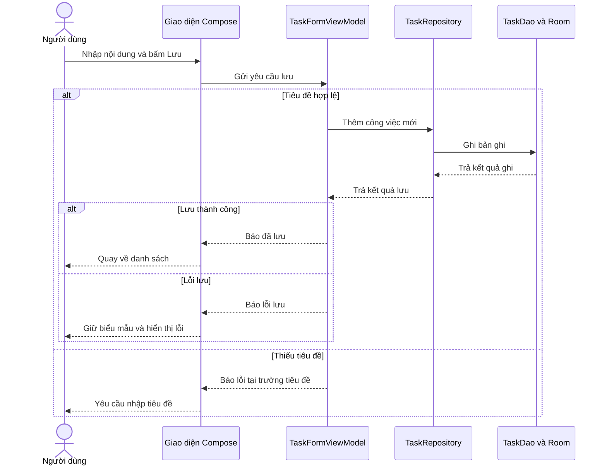

# Kiến trúc phần mềm ToDoList

Thiết kế đề xuất cho một người quản lý danh sách công việc cá nhân trong ứng dụng Android. Người dùng có thể xem, thêm, sửa, đánh dấu hoàn thành, mở lại và xóa công việc. Dữ liệu được lưu trên thiết bị để sử dụng ngoại tuyến và vẫn còn khi mở lại ứng dụng.

## Thành phần và luồng dữ liệu đề xuất

Thiết kế dùng MVVM trong module `:app`. Đường liền thể hiện thao tác và yêu cầu dữ liệu. Đường nét đứt thể hiện dữ liệu hoặc trạng thái trả về.

| Thành phần | Trách nhiệm |
| --- | --- |
| Giao diện Compose | Hiển thị danh sách và biểu mẫu thêm/sửa. Gửi sự kiện từ thao tác người dùng, hỏi xác nhận trước khi xóa và quay về danh sách khi biểu mẫu báo lưu thành công. |
| `TaskListViewModel` | Theo dõi danh sách công việc, xử lý đổi trạng thái và xóa. Cung cấp trạng thái đang tải, danh sách trống hoặc có dữ liệu, và lỗi. |
| `TaskFormViewModel` | Quản lý nội dung biểu mẫu, tải công việc theo ID khi sửa, kiểm tra tiêu đề và cung cấp trạng thái lưu cho giao diện. |
| `TaskRepository` | Cung cấp thao tác đọc và ghi cho ViewModel. Luồng danh sách lấy dữ liệu từ Room để giao diện tự cập nhật sau mỗi thay đổi. |
| `TaskDao` và Room | Đọc, thêm, cập nhật và xóa bản ghi trong cơ sở dữ liệu cục bộ. Room là nguồn dữ liệu duy nhất của danh sách. |

## Thao tác của người dùng

| Thao tác | Kết quả |
| --- | --- |
| Mở ứng dụng | Hiển thị các công việc đã lưu hoặc trạng thái danh sách trống. |
| Thêm công việc | Nhập tiêu đề và mô tả tùy chọn. Khi lưu thành công, danh sách hiển thị công việc mới ở trạng thái chưa hoàn thành. |
| Sửa công việc | Mở biểu mẫu từ một công việc hiện có. Khi lưu thành công, danh sách hiển thị nội dung mới của công việc đó. |
| Đánh dấu hoàn thành hoặc mở lại | Cập nhật trạng thái của công việc ngay từ danh sách. |
| Xóa công việc | Công việc biến mất khỏi danh sách sau khi người dùng xác nhận và thao tác xóa thành công. |

Biểu mẫu yêu cầu tiêu đề có nội dung sau khi bỏ khoảng trắng đầu và cuối. Nếu kiểm tra hoặc lưu thất bại, biểu mẫu giữ nội dung người dùng đã nhập và hiển thị lỗi để họ có thể sửa hoặc thử lại.

## Dữ liệu công việc

| Trường | Kiểu | Quy tắc |
| --- | --- | --- |
| `id` | `Long` | Khóa chính tự sinh, dùng để xác định công việc khi sửa, đổi trạng thái hoặc xóa. |
| `title` | `String` | Tiêu đề bắt buộc. |
| `description` | `String` | Mô tả tùy chọn, mặc định rỗng. |
| `isCompleted` | `Boolean` | Mặc định là `false` khi tạo. |

## Ví dụ luồng thêm công việc

Sau khi ghi thành công, Room phát danh sách mới qua repository đến `TaskListViewModel`. Giao diện danh sách hiển thị từ trạng thái mới đó.

## Cấu trúc hiện tại

| Đường dẫn | Vai trò |
| --- | --- |
| [settings.gradle.kts](../settings.gradle.kts) | Khai báo module `:app` và các kho Gradle. |
| [app/build.gradle.kts](../app/build.gradle.kts) | Cấu hình Android, Compose, dependencies và instrumentation runner. |
| [AndroidManifest.xml](../app/src/main/AndroidManifest.xml) | Khai báo ứng dụng và activity. |
| [MainActivity.kt](../app/src/main/java/com/example/todo_list/MainActivity.kt) | Điểm vào của ứng dụng, tạo repository và mở `TodoNavHost`. |
| [ui](../app/src/main/java/com/example/todo_list/ui) | Điều hướng, màn hình danh sách và biểu mẫu, cùng ViewModel của từng màn hình. |
| [ui/theme](../app/src/main/java/com/example/todo_list/ui/theme) | Bảng màu, kiểu chữ và `TodolistTheme`. |

## Luồng giao diện hiện tại

`MainActivity.onCreate` bật edge-to-edge rồi gọi `setContent`. `TodolistTheme` bọc `TodoNavHost`. Danh sách là màn hình đầu và mở biểu mẫu thêm hoặc sửa theo ID. Mỗi màn hình thu thập `StateFlow` theo vòng đời. Biểu mẫu giữ bản nháp bằng `SavedStateHandle` và được đóng khi ViewModel báo lưu thành công. Danh sách đang có trong ngăn xếp điều hướng nhận dữ liệu mới từ Room.

## Tầng dữ liệu hiện tại

Package `com.example.todo_list.data` chứa `Task`, `TaskDao`, `TaskDatabase` và `TaskRepository`. Room lưu dữ liệu trong `tasks.db`. `observeTasks()` phát danh sách theo ID giảm dần và phát lại khi dữ liệu thay đổi. Repository hỗ trợ tìm theo ID, thêm, sửa nội dung, đổi trạng thái và xóa. Tiêu đề được cắt khoảng trắng và phải có nội dung. Các thao tác sửa hoặc xóa trả về `false` nếu ID không tồn tại.
